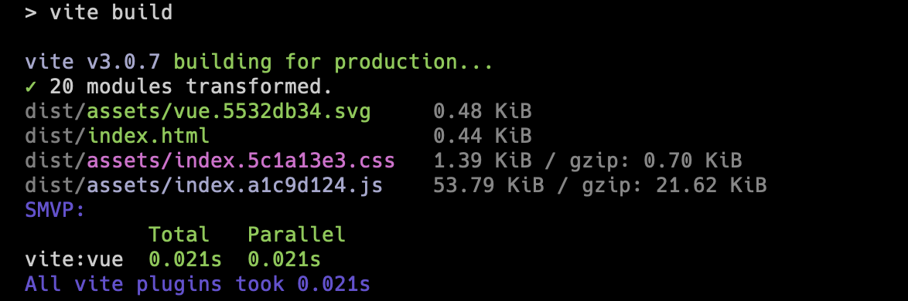

# speed-measure-vite-plugin

English | [简体中文](README.zh-CN.md)

[](https://www.npmjs.com/package/speed-measure-vite-plugin)
[](https://www.npmjs.com/package/speed-measure-vite-plugin)
[](https://github.com/lbb00/speed-measure-vite-plugin/blob/master/LICENSE)

Measure the execution and transform speed of your Vite plugins. The Vite equivalent of `speed-measure-webpack-plugin`.

Supports Vite 3, 4, 5, 6, and 7 (including the Vite 6+ Environment API). Zero runtime dependencies.



## Install

```bash
npm i -D speed-measure-vite-plugin
# or
pnpm add -D speed-measure-vite-plugin
```

## Usage

### Plugin Syntax (v3 Recommended)

Add `smvp()` directly into your `plugins` array like any standard Vite plugin:

```ts
// vite.config.ts
import { defineConfig } from 'vite'
import vue from '@vitejs/plugin-vue'
import smvp from 'speed-measure-vite-plugin'

export default defineConfig({
  plugins: [
    vue(),
    smvp({
      // options (optional)
    }),
  ],
})
```

### Wrapper Syntax (v2 Compatible)

Fully backwards-compatible with the legacy `smvp([vue()])` wrapper syntax. Wrap your `plugins` array with `smvp` (also required if you want to measure early lifecycle hooks like `config` or `configResolved`):

```ts
// vite.config.ts
import { defineConfig } from 'vite'
import vue from '@vitejs/plugin-vue'
import smvp from 'speed-measure-vite-plugin'

export default defineConfig({
  plugins: smvp([vue()], {
    // options (optional)
  }),
})
```

## Options

```ts
// Standard plugin syntax: smvp(options)
// Wrapper syntax compatible: smvp(plugins, options)
smvp({
  // Hooks to measure. Defaults to ['transform']
  hooks: ['transform', 'resolveId', 'load'],

  // Sort function for output. Defaults to descending by total time
  sort: (a, b) => b - a,

  // Minimum duration in ms for a plugin to appear in the output. Defaults to 0
  threshold: 5,

  // Debounce delay (ms) after the last hook execution in dev mode. Defaults to 1000
  gapTime: 1000,

  // Custom reporter callback. Defaults to 'terminal'
  output: (report) => {
    console.log(`Total time: ${report.allPluginsTotal}ms`)
  },

  // Temporarily disable measuring (e.g. in CI or via env var)
  disable: process.env.MEASURE === 'false',
})
```

| Option | Type | Default | Description |
| :--- | :--- | :--- | :--- |
| `hooks` | `string[]` | `['transform']` | Vite / Rollup hooks to measure (e.g. `transform`, `resolveId`, `load`). Early hooks (`config`, `configResolved`) require wrapper syntax. |
| `sort` | `(a: number, b: number) => number` | `(a, b) => b - a` | Sorter function for plugins and hooks in the terminal report. |
| `threshold` | `number` | `0` | Hide plugins taking less than this duration (in ms) to reduce noise. |
| `gapTime` | `number` | `1000` | In dev mode, wait this long (in ms) after the last hook call before flushing the report. (Alias: `maxGapTimeOnce`) |
| `output` | `'terminal' \| (report) => void` | `'terminal'` | Output destination. Pass a callback for custom logging or CI metric reporting. |
| `disable` | `boolean` | `false` | Disable measurement completely with zero overhead. |

## Notes

- **Dev Mode**: Since Vite processes files on-demand during dev, metrics are debounced and printed after requests go idle (`gapTime`).
- **Build Mode**: Metrics are collected across the entire build and printed on `closeBundle`.
- **Environment API**: In Vite 6+, plugin metrics are tracked per environment (`client`, `ssr`, etc.).

## License

[UNLICENSE](LICENSE)
