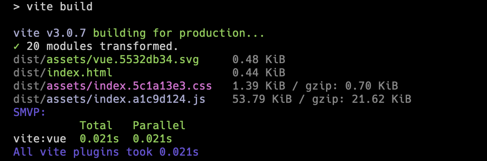

# speed-measure-vite-plugin

[English](./README.md) | 简体中文

[](https://www.npmjs.com/package/speed-measure-vite-plugin)
[](https://www.npmjs.com/package/speed-measure-vite-plugin)
[](https://github.com/lbb00/speed-measure-vite-plugin/blob/master/LICENSE)
[](https://bundlephobia.com/result?p=speed-measure-vite-plugin)
[](https://github.com/lbb00/speed-measure-vite-plugin)

用于测量 Vite 插件执行耗时与模块转换（transform）速度的轻量级性能分析工具，相当于 Vite 生态下的 `speed-measure-webpack-plugin`。

支持 **`vite >= v3`**（包括 Vite 3、4、5、6、7 以及 Vite 6/7 Environment API）。**零运行时依赖**。



## ✨ 特性

- 🚀 **标准 Vite 插件**：直接将 `smvp()` 放入 `plugins` 数组即可使用。
- 🔄 **100% 向后兼容**：旧版 `smvp([plugins])` 包装器语法继续无缝支持。
- 🎯 **全插件覆盖**：精准拦截所有插件 —— 用户业务插件、第三方框架插件（如 `@dcloudio/vite-plugin-uni`、`@vitejs/plugin-vue`、`@vitejs/plugin-react`）以及 Vite 内置插件（`vite:css`、`vite:esbuild`、`vite:json` 等）。
- ⚡️ **零运行时依赖**：纯原生 TypeScript 实现，无任何第三方包依赖，极小额外开销。
- 🛡️ **广泛兼容性**：完美兼容 Vite 3、4、5、6、7（含 Vite 6/7 Environment API）以及 Rollup 2/3/4 的各类 Hook 声明方式（普通函数与 `{ order, handler }` 对象形式）。
- ⏱️ **智能防抖开发模式**：无 CPU 占用过高的循环轮询或定时器泄漏，在请求批次或 HMR 空闲后自动防抖输出耗时报告。
- 📊 **多维耗时指标**：精准统计真实墙钟并行耗时（Parallel）、总耗时（Total）、并行加速比与单次调用平均耗时。
- 🎛️ **CI/CD 就绪**：支持自定义 `output` 回调函数，便于集成自动化构建性能监控与基准测试。

## 📦 安装

```bash
# npm
npm i -D speed-measure-vite-plugin

# pnpm
pnpm add -D speed-measure-vite-plugin

# yarn
yarn add -D speed-measure-vite-plugin
```

## 🚀 使用指南

### 1. 标准插件用法（推荐）

只需将 `smvp()` 添加到 Vite 配置的 `plugins` 列表中：

```typescript
// vite.config.ts
import { defineConfig } from 'vite'
import vue from '@vitejs/plugin-vue'
import smvp from 'speed-measure-vite-plugin'

export default defineConfig({
  plugins: [
    vue(),
    smvp(), // 👈 标准 Vite 插件写法
  ],
})
```

### 2. 框架集成用法（如 UniApp / Nuxt）

在 UniApp 等无头 CLI 终端运行的框架中，可通过 `threshold` 过滤微秒级微小插件，保持终端输出清爽：

```typescript
// vite.config.ts
import { defineConfig } from 'vite'
import uni from '@dcloudio/vite-plugin-uni'
import smvp from 'speed-measure-vite-plugin'

export default defineConfig({
  plugins: [
    uni(),
    smvp({
      // 过滤执行总耗时低于 5ms 的插件，终端展示更聚焦
      threshold: 5,
    }),
  ],
})
```

### 3. 旧版包装器语法（向后兼容）

现有项目中使用 v2 包装语法的配置无需做任何修改：

```typescript
// vite.config.ts
import { defineConfig } from 'vite'
import vue from '@vitejs/plugin-vue'
import smvp from 'speed-measure-vite-plugin'

export default defineConfig({
  plugins: smvp([vue()]), // smvp(plugins, options)
})
```

## ⚙️ 配置项

```typescript
smvp({
  // 需要测量的 Hook 列表，默认为 ['transform']
  hooks: ['transform', 'resolveId', 'load'],

  // 终端输出排序规则，默认为按耗时降序
  sort: (a, b) => b - a,

  // 插件显示的最小耗时阈值（毫秒），默认为 0
  // 大型项目中用于过滤零碎微小插件
  threshold: 5,

  // 开发服务器（dev 模式）下最后一次 hook 调用后的防抖等待时间（毫秒），默认为 1000
  gapTime: 1000, // 或使用 maxGapTimeOnce

  // 自定义指标输出处理函数（默认为 'terminal' 打印到控制台）
  // 适合 CI/CD 性能基准归档或自定义监控上报
  output: (report) => {
    console.log(`插件累计总耗时: ${report.allPluginsTotal}ms`)
  },

  // 是否停用测量（例如通过环境变量动态开启/关闭）
  disable: process.env.MEASURE === 'false',
})
```

### 配置参数速查表

| 配置项 | 类型 | 默认值 | 说明 |
| :--- | :--- | :--- | :--- |
| `hooks` | `(keyof Plugin \| string)[]` | `['transform']` | 需要测量的 Vite/Rollup Hook 列表（如 `transform`、`resolveId`、`load` 等）。测量早期配置钩子（`config`、`configResolved`）需使用包装器语法 `plugins: smvp([...], { hooks: [...] })`。 |
| `sort` | `(a: number, b: number) => number` | `(a, b) => b - a` | 控制台输出时的排序比较函数。 |
| `threshold` | `number` | `0` | 插件在控制台报告中展示的最低总耗时阈值（毫秒）。 |
| `gapTime` / `maxGapTimeOnce` | `number` | `1000` | 开发模式下，批次转换结束后输出耗时报告的防抖间隔时间（毫秒）。 |
| `output` | `'terminal' \| ((report: MeasureReport) => void)` | `'terminal'` | 报告输出目标。传入函数可实现自定义指标采集与监控。 |
| `disable` | `boolean` | `false` | 设置为 `true` 时跳过所有钩子包装与计时，零侵入直通。 |

## 🔬 工作原理

1. **`configResolved` 全局拦截**：在 Vite 解析完最终插件管线后统一捕获，包括用户插件、框架隐式注入插件以及 Vite 内部插件（`vite:css`、`vite:esbuild` 等）。
2. **多态 Hook 适配**：全面处理普通函数形式 Hook（`transform(code, id)`）与对象形式 Hook（`{ order: 'pre', handler }`），完整保留上下文 `this` 与原型继承。
3. **多环境支持**：深度兼容 Vite 6/7 的 Environment API（`config.environments`），独立追踪 `client`、`ssr` 与自定义运行时的插件耗时。
4. **生命周期自适应**：
   - **生产构建（Build 模式）**：汇总整个构建过程的插件耗时，在 `closeBundle` 结束阶段打印完整的汇总分析报告并自动恢复被测插件。
   - **开发调试（Dev 模式）**：按需转换结束后使用防抖机制统一输出批次报告，无额外轮询开销。

## 📄 开源许可

[UNLICENSE](LICENSE)
